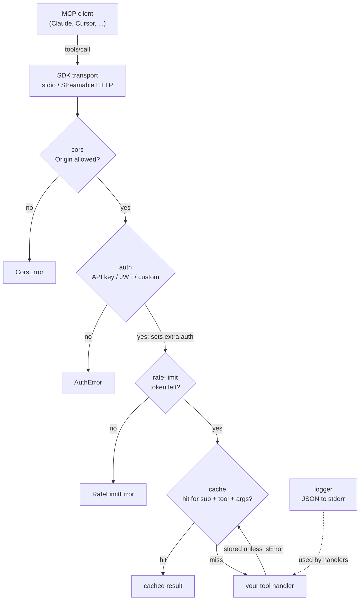

# MCP Toolkit


> TypeScript middleware toolkit for MCP servers - authentication, caching, rate limiting, CORS, logging (beta).

Stop reimplementing auth, caching, rate limiting, CORS, and logging for every MCP server. MCP Toolkit provides drop-in packages that work with the TypeScript SDK.

- **One line per concern.** `withAuth(server, ...)`, `withRateLimit(server, ...)`,
  `withCache(server, ...)`, `withCors(server, ...)` wrap every tool registered afterwards;
  your tool handlers do not change.
- **Zero runtime dependencies.** Each package is a single TypeScript file on Node's own
  `crypto`, `fs` and `Map`. The SDK is a peer dependency, never bundled.
- **Tested.** 78 unit tests (`node --test`, no test framework) cover every package,
  including the ordering, header-lookup and bypass cases listed under
  [Limitations](#limitations-and-compatibility).

Works with `@modelcontextprotocol/sdk` 1.x (verified on 1.32.1). The SDK v2 split
packages (`@modelcontextprotocol/server`) are not supported yet.

## Packages

| Package | Description | Status |
|---------|-------------|--------|
| [`@mcp-toolkit/auth`](packages/auth/) | API key and JWT authentication | Beta |
| [`@mcp-toolkit/cache`](packages/cache/) | Response caching with TTL and LRU | Beta |
| [`@mcp-toolkit/rate-limit`](packages/rate-limit/) | Rate limiting with token bucket | Beta |
| [`@mcp-toolkit/logger`](packages/logger/) | Structured logging with JSON output and log levels | Beta |
| [`@mcp-toolkit/cors`](packages/cors/) | Origin validation middleware | Beta |

## Quick Start

### Install

The `@mcp-toolkit/*` packages are not yet published to npm. Until then, clone and build from source:

```bash
git clone https://github.com/Sagargupta16/mcp-toolkit.git
cd mcp-toolkit
npm install
npm run build
```

### Usage with TypeScript SDK

```typescript
import { McpServer } from "@modelcontextprotocol/sdk/server/mcp.js";
import { StdioServerTransport } from "@modelcontextprotocol/sdk/server/stdio.js";
import { z } from "zod";
import { withAuth } from "@mcp-toolkit/auth";
import { withCache } from "@mcp-toolkit/cache";
import { withRateLimit } from "@mcp-toolkit/rate-limit";
import { createLogger } from "@mcp-toolkit/logger";

// Logs go to stderr by default, which is the only stream a stdio MCP server may
// write non-protocol bytes to.
const logger = createLogger({ level: "info", format: "json" });

const apiKey = process.env.MCP_API_KEY;
if (!apiKey) throw new Error("MCP_API_KEY is not set");

const server = new McpServer({
  name: "my-server",
  version: "1.0.0",
});

// Add middleware. Order matters - see below.
withAuth(server, {
  type: "api-key",
  keys: [apiKey],
});

withRateLimit(server, {
  strategy: "token-bucket",
  maxTokens: 100,
  refillRate: 10,
});

withCache(server, {
  ttl: 300,
  maxSize: 1000,
  strategy: "lru",
});

// Define tools - middleware applies automatically.
// inputSchema is a Zod raw shape (a plain object of Zod schemas), not JSON Schema.
// The deprecated `server.tool()` is wrapped the same way.
server.registerTool(
  "get-data",
  {
    description: "Fetch data with auth + cache + rate limiting",
    inputSchema: { query: z.string().describe("Search query") },
  },
  async ({ query }) => {
    logger.info("Fetching data", { query });
    const result = await fetchData(query);
    return { content: [{ type: "text", text: JSON.stringify(result) }] };
  },
);

// The packages compile to CommonJS, so there is no top-level await here.
const transport = new StdioServerTransport();
server.connect(transport).catch((error) => {
  logger.error("Failed to start", error as Error);
  process.exit(1);
});
```

### Order matters

Each `with*` call wraps the server's tool registration methods, so the **last**
middleware applied is the **innermost** one at call time. Apply them outermost
first: cors, auth, rate-limit, cache.

```typescript
withCors(server, { allowedOrigins: ["https://claude.ai"] }); // outermost
withAuth(server, { type: "api-key", keys: [apiKey] });
withRateLimit(server, { strategy: "token-bucket", maxTokens: 100, refillRate: 10 });
withCache(server, { strategy: "lru", ttl: 300, maxSize: 1000 }); // innermost
```

Getting this backwards is a data leak, not a style problem:

```typescript
// WRONG - cache is outside auth, so a cache hit returns before auth ever runs.
// An unauthenticated caller gets another user's cached response.
withCache(server, { strategy: "lru", ttl: 300 });
withAuth(server, { type: "api-key", keys: [apiKey] });
```

With auth applied first, `withCache` prefixes each key with the caller's
`payload.sub`. Note what that is worth per strategy: the built-in `api-key`
strategy reports the same `sub` (`"api-key-user"`) for every valid key, so all API
key callers share one cache namespace. Use `jwt` or `custom` auth, which carry a
real per-caller `sub`, when cached responses differ by caller.

## Package Details

### Auth

Multiple authentication strategies:

```typescript
// API Key
withAuth(server, { type: "api-key", header: "X-API-Key", keys: ["key1", "key2"] });

// JWT
withAuth(server, { type: "jwt", secret: process.env.JWT_SECRET, algorithms: ["HS256"] });

// Custom
withAuth(server, { type: "custom", verify: async (token) => isValid(token) });
```

### Cache

Response caching with multiple strategies:

```typescript
withCache(server, {
  strategy: "lru",       // lru | ttl
  ttl: 300,              // seconds
  maxSize: 1000,         // max entries
  keyGenerator: (toolName, args) => `${toolName}:${JSON.stringify(args)}`,
});
```

Both strategy values are served by one LRU-with-TTL cache: an entry leaves when it
exceeds `ttl` or when `maxSize` is reached, whichever comes first. `"ttl"` does not
currently select a different eviction policy.

### Rate Limit

Protect your server from abuse:

```typescript
withRateLimit(server, {
  strategy: "token-bucket",
  maxTokens: 100,
  refillRate: 10,            // per second
  onLimited: (req) => logger.warn("Rate limited", { tool: req.toolName }),
});
```

### Logger

Structured logging built for MCP servers:

```typescript
const logger = createLogger({
  level: "info",             // debug | info | warn | error
  format: "json",           // json | text
  transports: ["stderr", { type: "file", path: "./mcp-server.log" }],
});
```

Transports default to `["stderr"]`. Do not switch to `"stdout"` on a stdio server:
per the [MCP stdio transport spec](https://modelcontextprotocol.io/specification/2026-07-28/basic/transports/stdio)
(2026-07-28 revision), the server "MUST NOT write anything to its `stdout` that is not a
valid MCP message", and "MAY write UTF-8 strings to `stderr` for any logging purposes".
A log line on stdout corrupts the JSON-RPC stream. `"stdout"` is only safe when the
server does not speak MCP over stdio.

### CORS

Validate request origins when using HTTP or SSE transport:

```typescript
import { withCors } from "@mcp-toolkit/cors";

withCors(server, {
  allowedOrigins: ["https://myapp.com"],
});
```

The origin is read only from the real HTTP headers the SDK exposes at
`extra.requestInfo.headers`, case-insensitively. A caller cannot supply it through
`params._meta`: that is JSON-RPC body content the caller writes, so honouring it would
let any client name an allowed origin. A request with no origin is blocked whenever an
allowlist is configured, which is why applying `withCors` to a stdio server rejects
every call: stdio has no `Origin` to validate.

`allowedMethods` is optional and best-effort. The SDK's `RequestInfo` carries only
`headers` and `url`, so a tool handler usually cannot see the HTTP method at all; when
it is undetectable the request is allowed through. Enforce methods at your HTTP layer,
not here.

## Architecture

There is no middleware runtime. Each `withX(server, options)` call replaces
`server.tool` and `server.registerTool` with a version that wraps the handler before
registering it, so a tool registered afterwards runs inside every layer applied so far.
A guard on the returned `RegisteredTool` re-wraps a handler swapped in later through
`update({ callback })`, so the layers cannot be dropped after registration.



A thrown error reaches the SDK, which returns it to the client as a tool error.
`@mcp-toolkit/logger` is not a layer: it is a plain logger your handlers (and callbacks
such as `onLimited`) call.

### Design decisions

| Decision | Why |
|----------|-----|
| Patch the registration methods instead of the request router | `McpServer` has no per-call middleware hook (the SDK's own middleware is Express-level OAuth). Wrapping the handler at registration works on every transport without forking the SDK or replacing its `tools/call` handler. |
| Last applied runs innermost | It follows from wrapping at registration. Documented loudly because the wrong order puts the cache in front of auth. |
| Cache keys carry the caller's `sub` | Without it one caller's identity-dependent response is served to the next. |
| `Origin` read only from real HTTP headers | `params._meta` is body content the caller writes, so trusting it would let any client name an allowed origin. |
| Credentials accepted from headers or `params._meta` | stdio has no headers; `_meta` is its only per-request channel. |
| Bounded rate-limit buckets (`maxBuckets`, idle eviction) | Bucket keys come from callers, so an unbounded map is a memory-exhaustion vector. |
| Logger defaults to `stderr` | On stdio, stdout is the JSON-RPC stream. |
| No internal shared package | Each package publishes on its own. The registration-patching block is copied into four packages and kept byte-identical. |

## Limitations and compatibility

This is beta software. What does not work yet, stated plainly:

- **Tool registration only.** The middleware patches `server.tool()` and
  `server.registerTool()`. It does not intercept resources, prompts, or completions,
  so those run unauthenticated and unlimited.
- **Task-based tool handlers are not wrapped.** A handler registered as an object with
  a `createTask` method (the SDK's task execution shape) is not a function, so the
  patch forwards it untouched and no middleware runs for that tool.
- **Credentials come from request metadata, not from a session.** A credential is
  looked up in the HTTP headers at `extra.requestInfo.headers` (Streamable HTTP and
  SSE) or in the MCP request's `params._meta` (the only per-request channel stdio
  offers). `params._meta` is caller-written body content, which is fine for a
  credential the caller has to present anyway, but it is why the `withCors` origin
  check ignores it. There is no session-level authentication and no integration with
  the SDK's own OAuth support.
- **The `api-key` strategy does not distinguish callers.** Every valid key
  authenticates as one subject (`"api-key-user"`), so per-caller behaviour that keys
  off `payload.sub` -- notably cache scoping -- treats all API key holders as one
  caller. Use `jwt` or `custom` auth for a real per-caller identity.
- **The JWT verifier is HMAC-only.** `HS256`, `HS384` and `HS512` are verified with
  Node's `crypto`. `RS*`, `ES*` and `PS*` throw; use `type: "custom"` with a real
  library such as [`jose`](https://github.com/panva/jose) for asymmetric algorithms.
- **`withCors` is an origin allowlist, not CORS.** It is evaluated per tool call, so
  there is no preflight handling and no response headers, and it cannot reliably see
  the HTTP method. Under stdio there is no origin at all, so an allowlist blocks
  everything.
- **All state is in-process memory.** Cache entries and token buckets live in the
  current Node process. Nothing is shared across workers, replicas, or restarts, so
  rate limits are per-process rather than global.
- **The cache `strategy` field does not change eviction.** `"lru"` and `"ttl"` both
  use one LRU-with-TTL cache.

## Examples

See the [`examples/`](examples/) directory (and its [README](examples/README.md) for
how to run them):

- [Basic server with auth](examples/basic-auth-server.ts)
- [Full middleware stack](examples/full-middleware-stack.ts)
- [Full production setup](examples/production-server.ts)

## Contributing

Contributions welcome - new middleware, bug fixes, or docs improvements.

1. Fork this repo
2. Create a feature branch (`git checkout -b feat/my-middleware`)
3. Add your code with tests
4. Submit a PR

See [CONTRIBUTING.md](CONTRIBUTING.md) for full guidelines.

## More AI Developer Tools

| Project | Description |
|---------|-------------|
| [claude-cost-optimizer](https://github.com/Sagargupta16/claude-cost-optimizer) | Save 30-60% on Claude Code costs - proven strategies and benchmarks |
| [ai-git-hooks](https://github.com/Sagargupta16/ai-git-hooks) | AI-powered git hooks - auto-review diffs, generate commit messages, security scanning |
| [claude-code-recipes](https://github.com/Sagargupta16/claude-code-recipes) | Copy-paste recipes for Claude Code - commands, subagents, hooks, skills, MCP integration |
| [agent-recipes](https://github.com/Sagargupta16/agent-recipes) | AI agent workflows for real-world dev tasks - code review, testing, security |

## License

[MIT](LICENSE)
